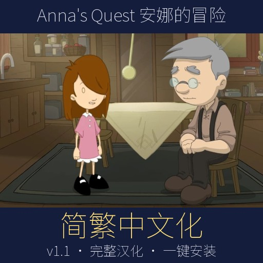
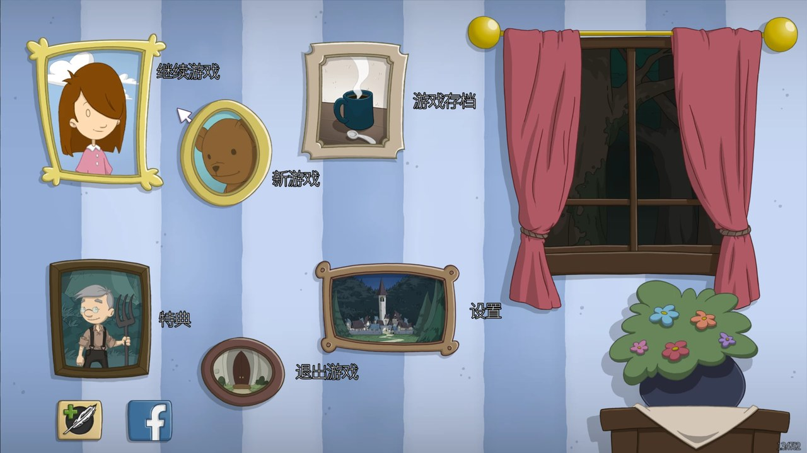
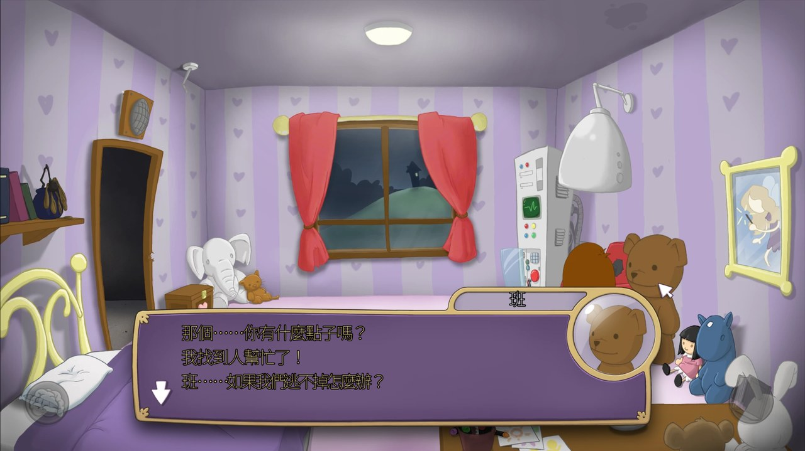
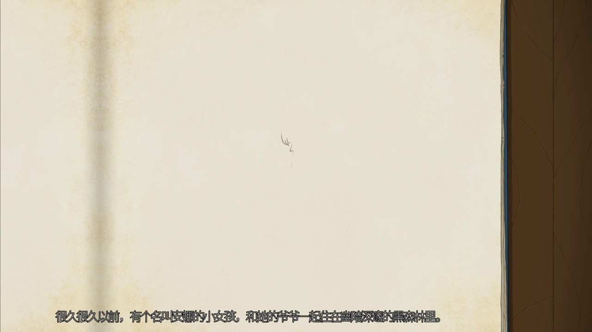
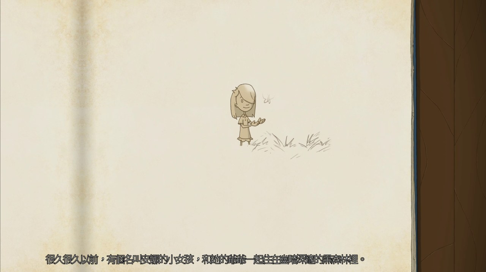

# 《Anna's Quest》安娜的冒险 完整中文化补丁（简体／繁体）

对应 Steam 版 **1.3.4792**（目前的 Steam 版本）。一键安装、一键还原，不用装任何软件。

**[⬇ 点这里到 Releases 下载 AnnasQuest_zh_v1.2.zip（约 32 MB）](https://github.com/toBerlinWay/AnnasQuest-zh/releases/latest)**

> 请从 Releases 下载 zip。直接点绿色 Code → Download ZIP 下载到的只有安装脚本，没有补丁文件，装不了。

## 转载说明

- **这是完整版汉化**：游戏内全部 11,810 句文字（对话、选项、物品名、界面、教程、片尾）和 16 段过场视频的 84 句字幕都已中文化（只有片尾人名保留原文）。
- **全部重新翻译，没有借鉴或使用 3DM 等任何旧汉化的内容，纯属个人作品。**
- 欢迎其他社区、论坛、群组转载分享（建议附上本页链接，方便大家拿到最新版）。
- **禁止其乐社区（Keylol）及其附属社区、群组与团体转载。** 不论是转贴文件、搬运到其他网盘、重新打包，还是只转贴下载链接，一律禁止；以个人名义代为转载也一样。

## 安装

1. 关闭游戏。
2. 解压 zip，双击 `安裝簡體中文.cmd`（简体）或 `安裝繁體中文.cmd`（繁体）。
3. 看到「完成」就可以开游戏，游戏语言保持 English 即可。
4. 如果提示「找不到游戏文件夹」，把整个解压后的文件夹放进游戏目录（Steam 库里右键游戏 → 管理 → 浏览本地文件）再运行一次。

简体、繁体随时可以互换，直接点另一个 .cmd 就好。已经装过 v1.1 的，直接装 v1.2 就会覆盖，不用先还原。

**还原英文**：双击 `還原英文原版.cmd`。第一次安装时会把原版文件备份到游戏目录的 `_zh_backup` 文件夹；也可以用 Steam 的「验证游戏文件完整性」。

## v1.2 更新内容

- 全新译本：全部 11,810 句文字和 84 句视频字幕从英文重新翻译，对白更口语，读起来更像中文原创的童话冒险。
- 简体版不是繁转简：按大陆玩家的说法逐句重写，语气词、用词和界面用语都改成大陆习惯。
- 逐句对照英文检查：没有漏翻，也没有对错句子，游戏代码和换行完整保留。
- 角色语气、译名和押韵的咒语延续 v1.1 的设定。

v1.1 及更早的版本在 [Releases](https://github.com/toBerlinWay/AnnasQuest-zh/releases) 里还能下载。

## 截图

| 简体版 | 繁体版 |
|---|---|
|  |  |
|  |  |
|  |  |

## 注意事项

- Steam 验证游戏文件或游戏更新后会变回英文，重新点一次安装即可。
- 只对应 Steam 版 1.3.4792；GOG 等其他版本未测试。补丁会先校验文件，不符合就直接拒绝，不会弄坏游戏。
- 补丁包是差分文件：不含游戏的图像、音效和视频，只含改过的文字、脚本数据和中文字体，必须有正版原文件才能安装。
- 安装脚本是纯 PowerShell，不联网，也不会改游戏以外的文件。源码在 [`source/`](source/)，可以用记事本打开检查。杀毒软件如果提示，是因为 .cmd 会调用 PowerShell 脚本。
- 语音是英文，字幕是中文。片尾英文人名之间的空格会被引擎吃掉（例如 Tom Kersten 会显示成 TomKersten），这是游戏引擎的限制。

## 繁體中文說明

見 [說明_繁體.txt](說明_繁體.txt)。简体完整说明见 [说明_简体.txt](说明_简体.txt)。

## 致谢与授权

- 游戏《Anna's Quest》版权归 Krams Design 与 Daedalic Entertainment 所有。本补丁为非官方玩家作品，请支持正版。
- 中文字体使用 Noto Sans TC／SC（© Adobe，SIL Open Font License 1.1），授权全文见 [字型授權_OFL.txt](字型授權_OFL.txt)。
- 翻译由 Google Gemini（通过 Antigravity）完成；工具、校对检查与测试由 Claude（AI）协助完成。
- 发现翻译错误或显示问题，欢迎在 [Issues](https://github.com/toBerlinWay/AnnasQuest-zh/issues) 回报，请附截图或那一句的英文原文。
